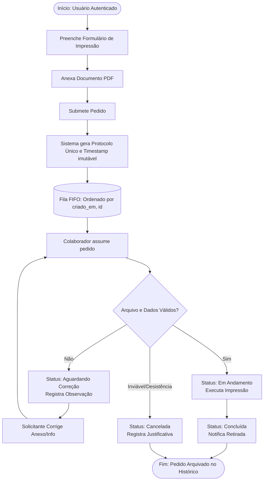
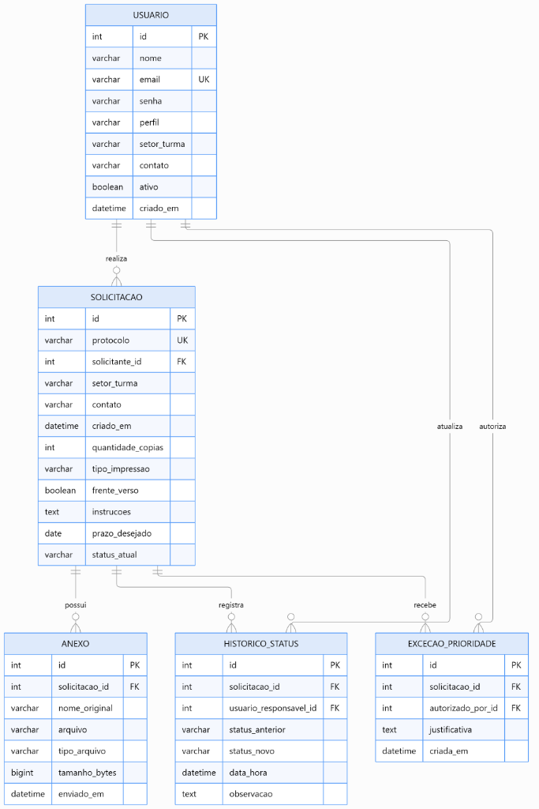
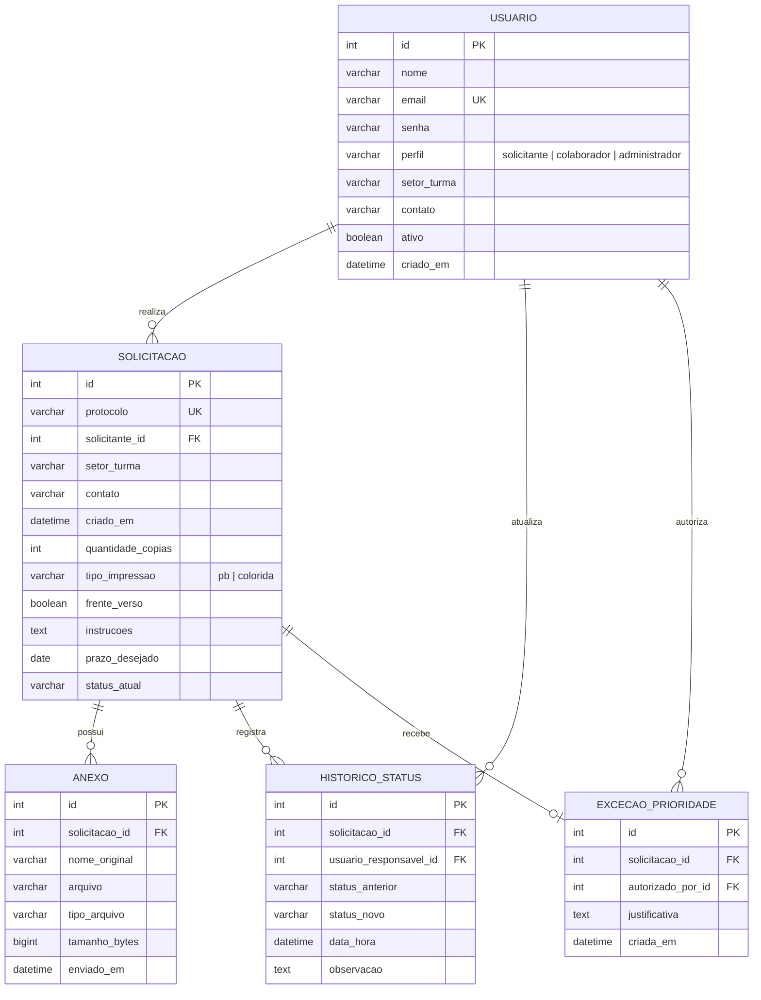

# Sistema de Solicitação e Gestão de Impressões

Plataforma web para centralizar pedidos, organizar a fila de atendimento e acompanhar o serviço do setor de impressos da escola, desenvolvida no âmbito do Projeto Integrador em **Desenvolvimento Web com Python e Django**.

---

## 1. Visão Geral do Projeto

Atualmente, o processo de solicitação de impressões na escola é conduzido majoritariamente via e-mail. Esse formato disperso gera gargalos como perda de mensagens, solicitações duplicadas, instruções incompletas, ausência de rastreamento e impossibilidade de o solicitante acompanhar a situação do seu pedido.

O **Sistema de Solicitação e Gestão de Impressões** substitui esse processo por uma plataforma digital centralizada com dois ambientes integrados:
1. **Área do Solicitante**: Portal intuitivo para envio de solicitações, upload seguro de arquivos (PDF), recebimento de protocolo único e acompanhamento do status em tempo real.
2. **Painel do Setor de Impressos**: Fila de trabalho estruturada segundo o princípio **FIFO** (*First In, First Out* — primeiro que chega, primeiro que é atendido), com ferramentas para conferência de arquivos, atualização de status e registro de histórico de atendimento.

---

## 2. Perfis de Acesso e Permissões

| Perfil | Descrição e Permissões Principais |
| :--- | :--- |
| **Solicitante** | Alunos, professores ou servidores. Acessa o formulário de pedido, anexa arquivos, consulta seus próprios pedidos e acompanha o status em tempo real. Não possui visibilidade sobre pedidos de terceiros. |
| **Colaborador do Setor** | Operadores da gráfica/impressão escolar. Visualiza a fila geral por ordem de chegada, abre documentos, inicia atendimentos, atualiza status e adiciona observações técnicas/pendências. |
| **Administrador** | Gestão institucional. Gerencia usuários, atribui perfis, configura opções do sistema, consulta auditorias completas e autoriza exceções de prioridade com justificativa. |

---

## 3. Fluxo de Funcionamento e Ciclo de Vida



### Estados da Solicitação (Status)

| Status | Significado e Ações Permitidas |
| :--- | :--- |
| `Recebida` | **Status inicial.** Pedido registrado com sucesso no banco de dados, aguardando triagem na fila FIFO. |
| `Em andamento` | Colaborador iniciou a conferência técnica ou execução do trabalho de impressão. |
| `Aguardando correção` | Identificada inconsistência (arquivo corrompido, formato inadequado, páginas faltantes). Permite reenvio pelo solicitante. |
| `Concluída` | Impressão e acabamentos finalizados; material pronto para retirada. |
| `Cancelada` | Pedido cancelado por solicitação do usuário ou recusa justificada da equipe técnica. |

---

## 4. Regras de Negócio Fundamentais

1. **Ordenação FIFO Rigorosa**: A fila de atendimento padrão é ordenada estritamente pela data e hora de criação (`criado_em` ASC). Em caso de empate, o identificador sequencial (`id` ASC) atua como critério de desempate.
2. **Imutabilidade do Registro Temporal**: O carimbo de data/hora original de submissão jamais é alterado durante atualizações de status ou correções.
3. **Protocolo Exclusivo**: Cada solicitação recebe um identificador único para rastreamento público e comunicação rápida com a equipe técnica.
4. **Isolamento de Dados (Privacidade)**: Solicitantes têm acesso estrito aos seus próprios pedidos. Documentos anexados não são públicos e possuem controle de acesso na camada de aplicação.
5. **Rastreabilidade e Auditoria**: Toda e qualquer transição de status gera um registro no modelo de histórico, gravando usuário responsável, data/hora, status anterior, novo status e observações.
6. **Exceção de Prioridade Controlada**: Atendimentos emergenciais que quebrem a ordem FIFO exigem perfil com privilégio administrativo ou de coordenação, acompanhados de justificativa obrigatória registrada em entidade própria (`ExcecaoPrioridade`).

---

## 5. Modelagem do Banco de Dados (DER)

A estrutura relacional foi projetada para garantir integridade referencial, histórico detalhado e escalabilidade:





---

## 6. Requisitos do Sistema

### 6.1 Requisitos Funcionais (RF)

- **RF01**: Permitir que usuários autenticados realizem login de acordo com seu perfil.
- **RF02**: Disponibilizar formulário completo para abertura de solicitação de impressão.
- **RF03**: Permitir upload de documento anexado (validação de formato PDF no MVP).
- **RF04**: Registrar automaticamente a data e a hora de recebimento geradas pelo servidor.
- **RF05**: Gerar número de protocolo único e sequencial para cada solicitação.
- **RF06**: Exibir aos colaboradores do setor uma fila organizada por ordem de chegada (FIFO).
- **RF07**: Permitir abertura e download seguro dos arquivos e instruções de cada pedido.
- **RF08**: Permitir atualização de status com inclusão de observações técnicas.
- **RF09**: Permitir que solicitantes consultem a lista e o andamento detalhado dos seus próprios pedidos.
- **RF10**: Manter histórico auditável de todas as transições de status.
- **RF11**: Permitir aos administradores a gestão de contas, perfis e permissões.
- **RF12**: Disponibilizar filtros no painel do setor (por status, período e solicitante) sem violar a ordenação padrão da fila.

### 6.2 Requisitos Não-Funcionais (RNF)

- **Usabilidade**: Interface limpa, responsiva (Bootstrap 5) e adaptável a desktops e dispositivos móveis.
- **Segurança**: Proteção contra CSRF, XSS, upload de extensões maliciosas e controle de acesso baseado em papéis (RBAC).
- **Armazenamento Seguro**: Arquivos armazenados em diretório protegido com entrega via view autenticada, nunca por URL estática pública.
- **Confiabilidade**: Persistência atômica das transições de status e rotinas preparadas para backup.
- **Compatibilidade**: Suporte aos principais navegadores modernos (Chrome, Firefox, Safari, Edge).

---

## 7. Tecnologias Utilizadas

- **Linguagem**: Python 3.10+
- **Framework Web**: Django 5.x / 6.x
- **Banco de Dados**: SQLite (desenvolvimento local) / PostgreSQL (ambiente de produção homologado)
- **Frontend**: Django Templates, HTML5 semântico, CSS3 e Bootstrap 5
- **Manipulação de Arquivos e Validação**: Python `mimetypes` e Django `FileField` com validadores customizados

---

## 8. Estrutura do Repositório

```text
projeto_integador_impressao/
├── config/                 # Configurações globais do Django
│   ├── __init__.py
│   ├── asgi.py
│   ├── settings.py         # Configuração de apps, banco de dados, auth e media
│   ├── urls.py             # Roteador raiz
│   └── wsgi.py
├── core/                   # Aplicação principal do sistema
│   ├── management/         # Comandos CLI customizados (backup, restauração, seed)
│   │   └── commands/
│   │       ├── backup_sistema.py
│   │       ├── restaurar_backup.py
│   │       └── seed_data.py
│   ├── migrations/         # Migrações do banco de dados (0001, 0002)
│   ├── templates/          # Templates HTML organizados por módulo
│   │   ├── base.html
│   │   ├── consulta.html   # Consulta pública por protocolo
│   │   ├── auth/           # Login e auto-cadastro
│   │   │   ├── login.html
│   │   │   └── cadastro.html
│   │   ├── solicitante/    # Minhas solicitações, nova e detalhes
│   │   │   ├── home.html
│   │   │   ├── nova_solicitacao.html
│   │   │   └── detalhe_solicitacao.html
│   │   ├── setor/          # Painel da fila FIFO e tela de atendimento
│   │   │   ├── painel.html
│   │   │   └── atendimento.html
│   │   └── admin_panel/    # Gestão administrativa e de usuários
│   │       ├── painel.html
│   │       └── usuarios.html
│   ├── static/             # Folhas de estilo CSS, scripts JS e imagens
│   ├── admin.py            # Customização do painel Django Admin nativo
│   ├── apps.py             # Configuração da app core
│   ├── forms.py            # Formulários Django com validações de PDF
│   ├── models.py           # Modelos de dados (Usuario, Solicitacao, Anexo, etc.)
│   ├── services.py         # Camada de serviços (protocolo, status atômico, exceções)
│   ├── tests.py            # Suíte completa com 19 testes automatizados
│   ├── urls.py             # Rotas internas da aplicação
│   └── views.py            # Lógica de controle, decorators e entrega segura
├── docs/                   # Documentação de apoio, DER e homologação
│   ├── Documento_Norteador_Sistema_Solicitacao_Impressos.docx
│   ├── diagrama_er_banco.png
│   ├── Plano_Implantacao_Piloto.md
│   └── Aprovacao_Publicacao.md
├── scripts/                # Scripts de automação (backup diário e demonstração)
│   ├── demonstrar_funcionalidades.py
│   ├── executar_backup.ps1
│   └── executar_backup.sh
├── backups/                # Diretório local de snapshots (ignorado no Git)
├── media/                  # Armazenamento privado de anexos PDF
├── .gitignore              # Regras de exclusão do controle de versão
├── AGENTS.md               # Diretrizes operacionais para Agentes de IA e Devs
├── README.md               # Documentação principal do projeto
├── manage.py               # Utilitário CLI do Django
└── requirements.txt        # Dependências do ecossistema Python
```

---

## 9. Como Executar o Projeto Localmente

### Pré-requisitos
- Python instalado (versão 3.10 ou superior)
- Git

### Passo a Passo

1. **Clone o repositório ou acerte a pasta de trabalho**:
   ```bash
   cd c:\Users\ALUNO\Documents\projeto_integador_impressao
   ```

2. **Crie e ative o ambiente virtual (`venv`)**:
   - No Windows (PowerShell):
     ```powershell
     python -m venv venv
     .\venv\Scripts\Activate.ps1
     ```

3. **Instale as dependências**:
   ```bash
   pip install django
   ```
   *(Caso exista `requirements.txt`: `pip install -r requirements.txt`)*

4. **Execute as migrações do banco de dados**:
   ```bash
   python manage.py makemigrations
   python manage.py migrate
   ```

5. **Crie uma conta de Administrador**:
   ```bash
   python manage.py createsuperuser
   ```

6. **Inicie o servidor de desenvolvimento**:
   ```bash
   python manage.py runserver
   ```

7. **Acesse no navegador**:
   - Aplicação: [http://127.0.0.1:8000/](http://127.0.0.1:8000/)
   - Painel Administrativo: [http://127.0.0.1:8000/admin/](http://127.0.0.1:8000/admin/)

### 9.1 Rotina de Backup e Restauração

O sistema possui uma rotina automatizada que consolida em arquivo comprimido (`.zip`):
- Snapshot consistente do banco de dados (SQLite via API de backup a quente).
- Dump dos dados relacionais em JSON (`dumpdata`).
- Todos os arquivos de documentos anexados (`media/`).
- Manifesto com metadados e data/hora.
- Política de retenção configurável (elimina automaticamente backups antigos).

**Para executar o backup manualmente**:
```bash
python manage.py backup_sistema --keep 7
```

**Para validar ou restaurar um backup**:
```bash
# Simulação (dry-run):
python manage.py restaurar_backup backups/backup_sistema_YYYYMMDD_HHMMSS.zip

# Confirmação de restauração:
python manage.py restaurar_backup backups/backup_sistema_YYYYMMDD_HHMMSS.zip --confirmar
```

**Automação com Agendador de Tarefas / Cron**:
- Windows: Executar [scripts/executar_backup.ps1](file:///c:/Users/ALUNO/Documents/projeto_integador_impressao/scripts/executar_backup.ps1) via Agendador de Tarefas do Windows.
- Linux: Executar [scripts/executar_backup.sh](file:///c:/Users/ALUNO/Documents/projeto_integador_impressao/scripts/executar_backup.sh) via Cron.

---

## 10. Roteiro de Etapas de Desenvolvimento

- [x] **Etapa 1: Levantamento de Requisitos e Fluxos** (Concluída - Documento Norteador & DER)
- [x] **Etapa 2: Especificação de Arquitetura e Modelagem** (Concluída)
- [x] **Etapa 3: Preparação do Ambiente e Modelos Django** (Concluída - Modelos, Custom User, Migrações e Testes)
- [x] **Etapa 4: Portal do Solicitante** (Concluída - Login, Minhas Solicitações, Formulário com upload de PDF e Protocolo)
- [x] **Etapa 5: Painel do Setor de Impressos** (Concluída - Fila FIFO por ordem de chegada, Tela de Atendimento e Atualização de Status)
- [x] **Etapa 6: Segurança, Validações e Testes de Aceitação** (Concluída - Row-level security, isolamento de anexos e 19 testes automatizados aprovados)
- [x] **Etapa 7: Implantação Piloto e Homologação Escolar** (Concluída - Plano operacional estruturado em docs/Plano_Implantacao_Piloto.md)
- [x] **Etapa 8: Publicação e Treinamento** (Concluída - Sistema aprovado para publicação institucional em docs/Aprovacao_Publicacao.md)

---

## 11. Licença e Responsáveis

Projeto desenvolvido como **Projeto Integrador de Desenvolvimento Web** (Escola Técnica / Instituição de Ensino).
- **Tecnologias**: Python + Django
- **Ano**: Novembro de 2026
